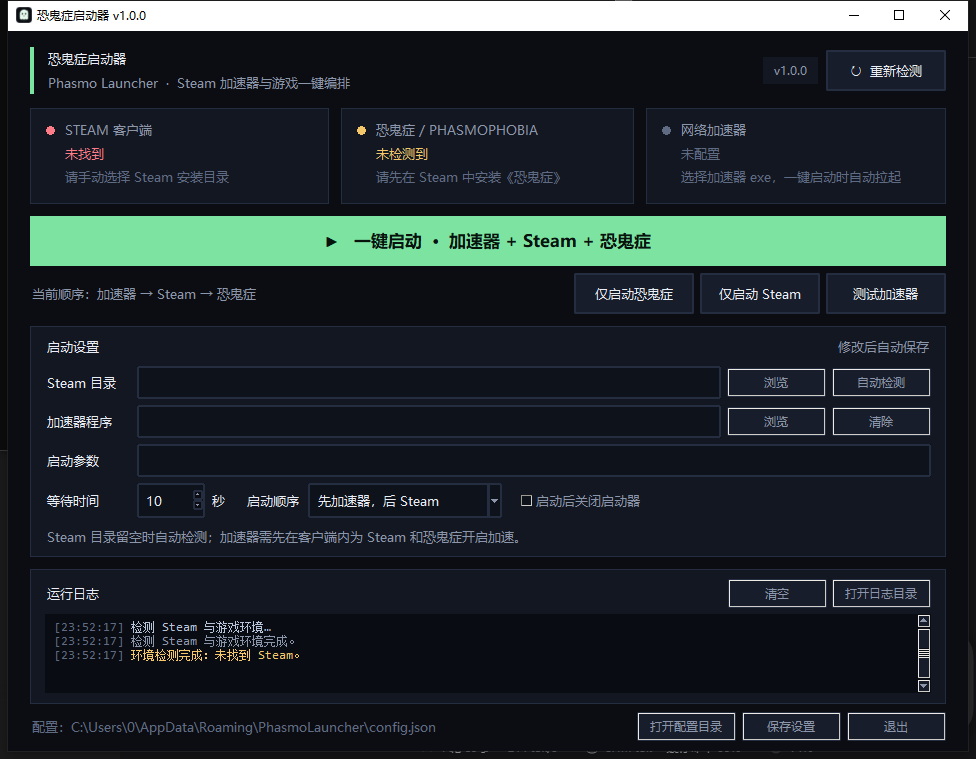

# 恐鬼症启动器

> Phasmo Launcher —— 一键拉起加速器、Steam 与《恐鬼症》（Phasmophobia）。




## 简介

这是一个使用 **Python + tkinter** 编写的 Windows 桌面启动器，用一条流程完成：

```text
第三方加速器  →  Steam  →  Phasmophobia（恐鬼症）
```

也可以分别执行「仅启动游戏」「仅启动 Steam」「测试加速器」。

程序会自动定位 Steam 安装目录，读取 `libraryfolders.vdf`，在多个 Steam 库中查找
`appmanifest_739630.acf`，确认《恐鬼症》确实安装后再通过
`steam://rungameid/739630` 唤起游戏。

> **关于“加速”**：本项目**不内置 VPN、代理或加速节点**，不会修改系统网络设置、
> hosts 或代理。加速能力来自你电脑上已经安装的第三方加速器；启动器负责按你配置的
> 顺序自动拉起它，并继续启动 Steam 与游戏。请先在该加速器客户端里为
> **Steam / 恐鬼症** 选择线路并开启加速。

## 功能

- 一键流程：加速器 → Steam → 恐鬼症，顺序可切换
- 自动检测 Steam（注册表 + 常见安装路径）
- 支持 Steam 多库：解析 `libraryfolders.vdf`，识别非 C 盘游戏库
- 游戏完整性预检：找不到 `Phasmophobia.exe` 时明确提示，不盲目启动
- 启动器界面实时显示 Steam / 游戏 / 加速器状态
- 加速器支持 `.exe`、`.com`、`.lnk` 和自定义 URL 协议（如 `uu://`）
- 可配置加速器参数、等待时间、启动后自动退出
- 配置原子写入，损坏时自动回退默认配置，不阻塞启动
- 零运行时第三方依赖，只用 Python 标准库
- 提供无界面 CLI：环境自检、脚本化启动
- 单元测试覆盖配置、Steam 解析、参数解析和启动编排

## 环境要求

| 项目 | 要求 |
| --- | --- |
| 操作系统 | Windows 10 / 11（64 位） |
| Python | 3.10 及以上，安装时勾选 `Add Python to PATH` |
| 依赖 | 运行时无第三方依赖；tkinter 随官方 Python 一起安装 |
| Steam | 已安装并至少登录过一次 |
| 游戏 | Steam 库中已安装《恐鬼症》（AppID `739630`） |
| 加速器 | 可选但“一键加速”流程必需，需自行安装并登录 |

## 快速开始

### 方式一：双击运行

```text
run.bat
```

`run.bat` 优先使用 `pythonw.exe` 启动，不显示控制台窗口。

### 方式二：命令行运行

```powershell
cd 恐鬼症启动器
python main.py
```

### 方式三：只做环境检查

```powershell
python main.py --check
```

或双击 `check.bat`。

### 首次配置

1. 启动后程序会自动检测 Steam 与游戏。
2. 如果 Steam 未被识别，在「Steam 目录」中点「浏览」，选择包含 `steam.exe` 的目录。
3. 在「加速器程序」中点「浏览」，选择加速器主程序（`.exe`）或桌面快捷方式（`.lnk`）。
4. 如果加速器需要参数，填在「启动参数」中，例如
   `--profile "Phasmophobia"`。
5. 设置「等待时间」：启动加速器后等待多少秒再启动 Steam。建议 8–20 秒。
6. 点击绿色「一键启动」按钮。

程序会在发出游戏启动请求后结束流程；Steam 和游戏由 Steam 自己接管，启动器退出不会
关闭它们。

## 配置说明

配置文件默认位于：

```text
%APPDATA%\PhasmoLauncher\config.json
```

日志位于：

```text
%APPDATA%\PhasmoLauncher\logs\launcher.log
```

可用环境变量 `PHASMO_LAUNCHER_HOME` 覆盖应用数据目录，便于便携使用或测试。

```json
{
  "steam_path": "",
  "accelerator_path": "C:\\Program Files\\UU\\UU.exe",
  "accelerator_args": "",
  "accelerator_wait_seconds": 10,
  "launch_order": "accelerator_first",
  "close_after_launch": false
}
```

| 字段 | 说明 |
| --- | --- |
| `steam_path` | Steam 根目录；留空自动检测 |
| `accelerator_path` | 加速器 `.exe` / `.com` / `.lnk`，或带协议 URL |
| `accelerator_args` | 传给加速器的参数，支持双引号 |
| `accelerator_wait_seconds` | 拉起加速器后等待秒数，0–300 |
| `launch_order` | `accelerator_first` 或 `steam_first` |
| `close_after_launch` | 发出游戏启动请求后是否自动关闭启动器 |

界面修改会自动保存，无需手动点保存；底部的「保存设置」用于立即落盘。

## 启动顺序怎么选

| 顺序 | 适合场景 |
| --- | --- |
| 先加速器，后 Steam（默认） | 希望 Steam 登录、商店与游戏流量都先进入加速线路 |
| 先 Steam，后加速器 | 加速器要求 Steam 已经运行时才能识别游戏进程 |

具体以你使用的加速器说明为准。若加速器只在游戏启动后才接管流量，建议使用默认顺序并
适当增加等待时间。

## 命令行

```powershell
# 环境自检，不启动任何程序
python main.py --check

# 无界面执行一键流程
python main.py --launch all

# 只启动游戏 / 只启动 Steam / 只拉起加速器
python main.py --launch game
python main.py --launch steam
python main.py --launch accelerator

# 调试日志
python main.py --debug
```

`--check` 的退出码：`0` 表示 Steam 和游戏都已就绪，`1` 表示有项目未就绪。
`--launch` 的退出码：`0` 成功，`2` 预检失败或启动超时。

## 项目结构

采用常见 GitHub Python 项目的 `src` 布局：

```text
恐鬼症启动器/
├─ .github/
│  └─ workflows/
│     └─ build.yml              # CI：测试 + 打包 Windows 程序
├─ assets/
│  ├─ app.ico                   # 应用图标
│  ├─ icon.png                  # 图标预览
│  ├─ icon.svg                  # 矢量图标
│  └─ version_info.txt          # exe 版本信息
├─ docs/
│  ├─ architecture.md           # 模块与流程说明
│  ├─ screenshot.png            # 界面截图
│  ├─ troubleshooting.md        # 常见问题
│  └─ usage.md                  # 详细使用说明
├─ scripts/
│  ├─ build.ps1                 # 一键打包 Windows 程序
│  ├─ generate_icon.py          # 生成 ico/png 图标
│  └─ run.ps1                   # PowerShell 启动包装
├─ src/
│  └─ phasmo_launcher/
│     ├─ __init__.py
│     ├─ __main__.py            # python -m phasmo_launcher
│     ├─ accelerator.py         # 加速器参数与启动
│     ├─ app.py                 # tkinter 界面
│     ├─ cli.py                 # CLI 入口
│     ├─ config.py              # 配置模型与原子写入
│     ├─ constants.py           # AppID、常量
│     ├─ launcher.py            # 启动编排与预检
│     ├─ logging_setup.py       # 滚动日志
│     ├─ paths.py               # 数据目录、资源路径
│     ├─ steam.py               # Steam / 游戏库检测
│     ├─ windows.py             # 进程、启动、tasklist
│     └─ ui/
│        ├─ __init__.py
│        ├─ theme.py            # 深色主题
│        └─ widgets.py          # 状态卡片
├─ tests/
│  ├─ __init__.py
│  ├─ test_accelerator.py
│  ├─ test_config.py
│  ├─ test_launcher.py
│  └─ test_steam.py
├─ .editorconfig
├─ .gitattributes
├─ .gitignore
├─ CHANGELOG.md
├─ CONTRIBUTING.md
├─ LICENSE
├─ README.md
├─ check.bat
├─ config.example.json
├─ main.py
├─ pyproject.toml
├─ requirements-dev.txt
├─ requirements.txt
└─ run.bat
```

## 开发与测试

```powershell
# 运行全部单元测试
python -m unittest discover -s tests -t . -v
```

测试不访问网络、不启动真实 Steam/游戏，也不依赖 Windows 注册表。启动编排通过依赖注入
替换进程检查、启动器和 `sleep`，因此可以在任何平台跑通。

```powershell
# 可选：安装为开发模式
python -m pip install -e .
phasmo-launcher            # 打开图形界面
phasmo-launcher-cli --check
```

## 打包为 exe

```powershell
powershell -ExecutionPolicy Bypass -File scripts\build.ps1
```

脚本会安装 PyInstaller / Pillow，重新生成图标，执行测试，并输出文件夹版程序与压缩包：

```text
dist\恐鬼症启动器\恐鬼症启动器.exe
dist\恐鬼症启动器-windows-x64.zip
```

解压 zip 后双击 `恐鬼症启动器.exe`，目标机器不需要安装 Python。文件夹版启动更快，也更
不容易被 SmartScreen 误判。如果确实需要单文件 exe：

```powershell
powershell -ExecutionPolicy Bypass -File scripts\build.ps1 -OneFile
```

单文件版输出为 `dist\恐鬼症启动器.exe`；首次运行需要把运行时释放到临时目录，启动会稍慢。
未签名的 exe 可能触发 Windows SmartScreen，选择「更多信息 → 仍要运行」即可；正式分发
建议自行签名。

## 常见问题

更多内容见 [docs/troubleshooting.md](docs/troubleshooting.md)。

<details>
<summary>提示「未找到 Steam」</summary>

在界面中选择包含 `steam.exe` 的 Steam 根目录，然后点「自动检测」或重新检测。
如果 Steam 装在非默认目录，通常是 `D:\Steam`、`D:\Program Files (x86)\Steam` 等。

</details>

<details>
<summary>提示「未检测到恐鬼症」</summary>

先在 Steam 中安装游戏并确认 `Phasmophobia.exe` 存在。程序会检查所有
`libraryfolders.vdf` 列出的库，但仍要求游戏文件完整。

</details>

<details>
<summary>加速器启动了，但游戏没有走加速线路</summary>

启动器只负责拉起加速器，不控制其内部线路选择。请先在加速器客户端中为
Steam / 恐鬼症选择节点并开启加速，再使用一键启动。部分加速器需要以管理员身份运行。

</details>

<details>
<summary>Steam 启动超时</summary>

手动打开 Steam 并完成登录 / Steam Guard 验证后再试。首次登录、客户端更新或网络异常
都会让启动时间超过默认的 60 秒。

</details>

## 设计边界与安全

- 不读取、不保存 Steam 账号密码，不注入游戏进程，不修改游戏文件。
- 不内置任何网络加速、代理、VPN 或节点；不修改系统网络配置。
- 配置与日志只写入 `%APPDATA%\PhasmoLauncher`。
- 加速器路径由用户自己选择；程序只按该路径启动，不会自动下载第三方软件。
- `steam://` 协议由系统注册的 Steam 客户端处理。

## 许可证

[MIT](LICENSE) © 2026 Phasmo Launcher Contributors

本项目与 Valve、Steam、Kinetic Games 及任何加速器厂商均无关联。
《Phasmophobia》《恐鬼症》相关名称与商标归其各自权利人所有。
